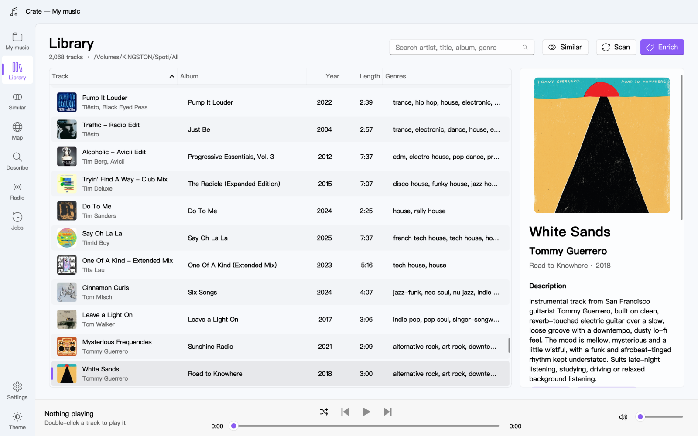
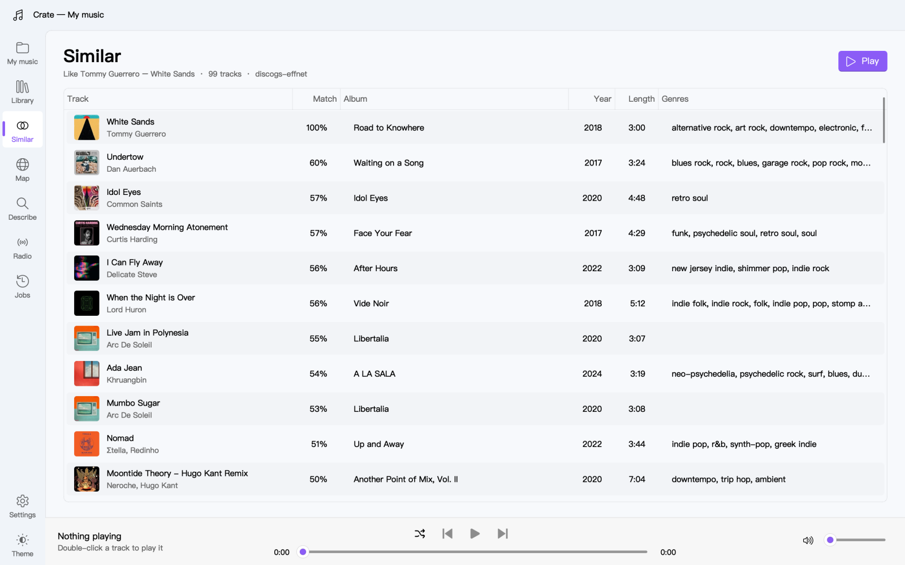
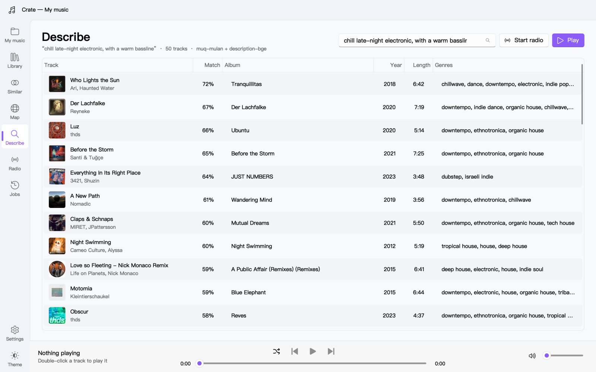
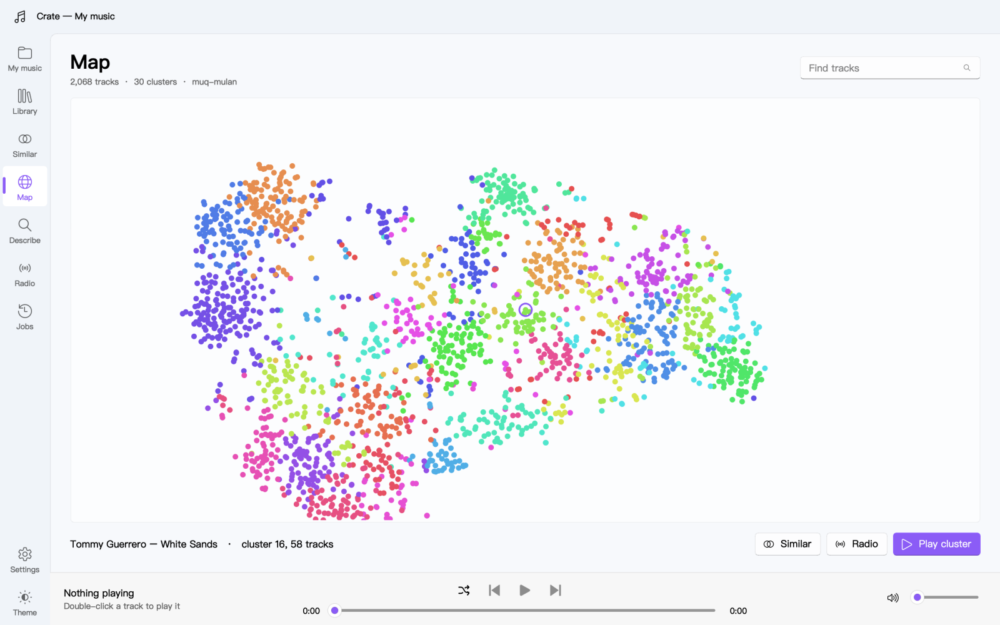
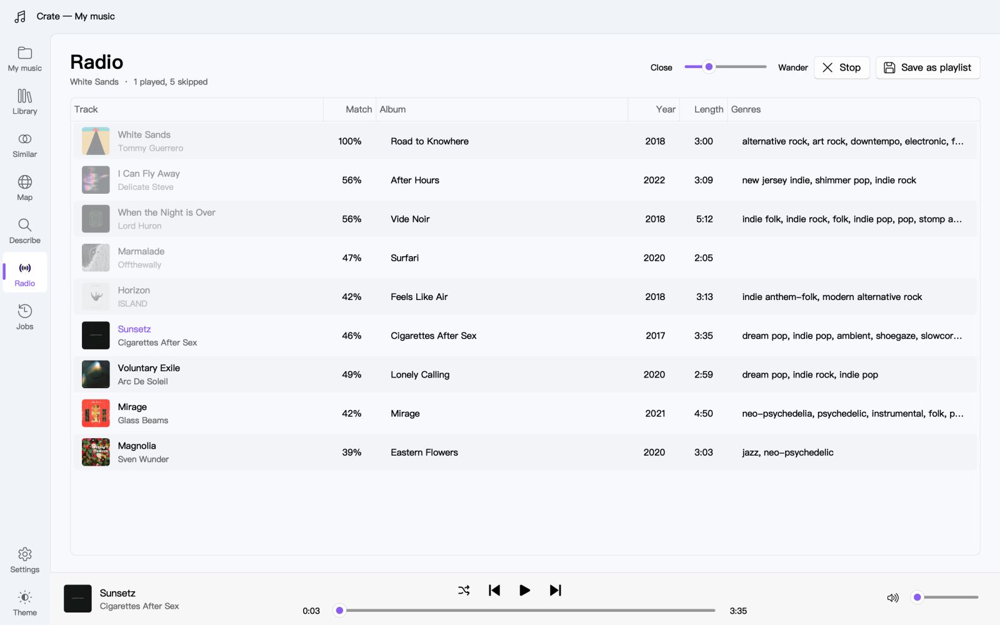
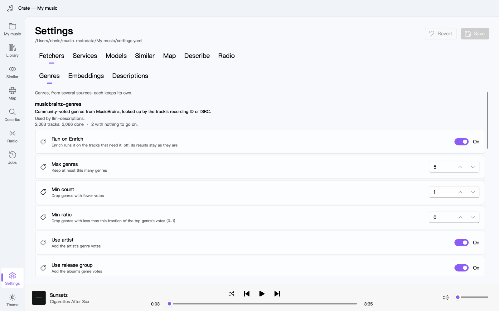

# crate

A desktop app for a FLAC music library: browse it, enrich it with genres, descriptions and audio embeddings, and find music by how it sounds. You can list the tracks most like one, search with a description ("chill late-night electronic, with a warm bassline"), explore a map of the library, or play an endless radio station that steers by what you skip.

The repository is a [uv](https://docs.astral.sh/uv/) workspace with two packages:

- [`crate`](crate/README.md): the app, built with PySide6 and PySide6-Fluent-Widgets.
- [`libcrate`](libcrate/README.md): the backend the app uses in-process. It holds the catalog, the fetchers that fill it (MusicBrainz, chosic, Essentia, a language model, CLAP models), the embeddings, and the similar-tracks, describe, radio and map features.

## Screenshots

From a library of about 2,000 tracks.

The library: every track with its cover, genres from each source, and the selected track's description.

<picture>
  <source media="(prefers-color-scheme: dark)" srcset="docs/screenshots/library-dark.png">
  
</picture>

Similar: the tracks that sound most like the chosen one.

<picture>
  <source media="(prefers-color-scheme: dark)" srcset="docs/screenshots/similar-dark.png">
  
</picture>

Describe: the tracks that sound like a description, from their sound and their written descriptions.

<picture>
  <source media="(prefers-color-scheme: dark)" srcset="docs/screenshots/describe-dark.png">
  
</picture>

The map: the whole library laid out by how it sounds, coloured by cluster.

<picture>
  <source media="(prefers-color-scheme: dark)" srcset="docs/screenshots/map-dark.png">
  
</picture>

Radio: an endless station from a track; skipped tracks fade and steer it away from tracks like them.

<picture>
  <source media="(prefers-color-scheme: dark)" srcset="docs/screenshots/radio-dark.png">
  
</picture>

Settings: each fetcher with what it does, what uses it and how far it is on the catalog.

<picture>
  <source media="(prefers-color-scheme: dark)" srcset="docs/screenshots/settings-dark.png">
  
</picture>

## Running it

```sh
uv sync
uv run crate
```

It needs Python 3.12 and [VLC](https://www.videolan.org/vlc/) for playback. It has only been used on macOS.

In the app, **New catalog** scans a music folder into a catalog folder. That folder holds `catalog.json`, `settings.yaml`, the embeddings and the cover thumbnails; the music files are only read. Then turn on the fetchers you want in **Settings › Fetchers** and press **Enrich**. Enrich downloads the models it needs into `~/crate_models` (the `models.folder` setting).

The language-model fetchers need an API key, set in **Settings › Services** or with the provider's environment variable (`ANTHROPIC_API_KEY`, ...). Each of their calls costs money: with the default model, about $3 for LLM genres and $10 for descriptions per 2,000 tracks.

## Tests

```sh
uv run --package libcrate pytest libcrate
uv run --package crate pytest crate
```

The tests make their own small FLAC files. The tests on real recordings (Essentia, the CLAP models, playback) use a `test_music/` folder of tagged FLACs at the repo root, which isn't in the repository, and are skipped without it.
